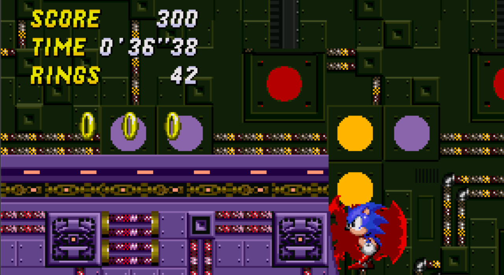

<div align="center">

# SONIC 2
# THE TRUE HISTORY

**El Sonic 2 que pudo haber sido.**

Zonas descartadas. Eras reordenadas. Un viaje a través del tiempo.

[**Descargar v1.0**](https://github.com/ehanielchavez-netizen/Sonic2-The-True-History/releases/latest) · [Sitio web](https://ehanielchavez-netizen.github.io/Sonic2-The-True-History/es.html) · [English](README.md) · [Créditos](CREDITS.md)



</div>

> **Proyecto fan.** Sonic the Hedgehog y sus personajes pertenecen a SEGA.
> Sonic 2 Absolute es un proyecto fan de Team Forever. Este mod no es oficial,
> no tiene fines de lucro y no está afiliado a SEGA ni a Team Forever.

---

## Acerca del mod

**Sonic 2: The True History** es un mod de campaña para **Sonic 2 Absolute 1.1.1
Easy Setup**. Reconstruye la aventura como una versión de historia alternativa de
Sonic 2: las zonas perdidas sobrevivieron, el orden de las eras cambió y todo el
juego se convirtió en una historia de viaje en el tiempo.

No es un cambio de colores ni un reskin. El proyecto cambia la estructura de la
campaña, el Level Select, la progresión de eras y el flujo del final; además
importa varias zonas y pistas musicales de otros mods de la comunidad. También
agrega transiciones propias como el **Warp Point** y **Hidden Palace**.

La descarga contiene **solo el mod**. El repositorio también aloja este sitio web.
**No** incluye Sonic 2 Absolute, el juego base, una ROM ni ningún ejecutable del
juego.

---

## La campaña

| Era | Zonas |
| --- | --- |
| **Presente** | Emerald Hill · Ocean Wind · Jungle Woods · Sand Shower · Metropolis |
| **Pasado** | Tropical Sun · Aquatic Ruin · Blue Ocean · Hill Top |
| **Presente arruinado** | Rock World · Oil Ocean · Mystic Cave |
| **Futuro** | Casino Night · Chemical Plant · Genocide City |
| **Última batalla** | Sky Chase · Wing Fortress · Death Egg |

**18 zonas en 5 eras**, más las transiciones de Warp Point y Hidden Palace.

Notas importantes y honestas:

- **Blue Ocean es Hydrocity renombrado**, no un nivel nuevo desde cero.
- **Genocide City 2 no está incluido** en esta versión.
- **La última batalla usa el Death Egg original.** No hay Death Egg extra,
  Gauntlet ni arena con todos los jefes.
- **Rock World** aparece solo en el Presente arruinado para no duplicar la zona
  en dos eras.

---

## Características

- **Una campaña reordenada.** Las cinco eras están conectadas como una sola
  historia en lugar de la progresión original.
- **Zonas perdidas recuperadas.** Ocean Wind, Jungle Woods, Sand Shower,
  Tropical Sun, Blue Ocean, Rock World y Genocide City forman parte de la ruta
  principal.
- **Level Select y menús propios.** El mod cambia la presentación y el orden de
  eras del juego.
- **Transiciones con Warp Point.** El primer Warp Point conserva su secuencia
  animada personalizada.
- **Hidden Palace.** El segundo Warp Point lleva a Hidden Palace y de ahí al
  Presente arruinado.
- **Un final completo.** Sky Chase, Wing Fortress y el Death Egg original cierran
  la campaña.
- **Banda sonora comunitaria.** Música original de Sonic, remixes y pistas de
  proyectos comunitarios acreditados.
- **Diseñado como capa.** El mod está pensado para funcionar encima de Sonic 2
  Absolute sin reemplazar los archivos principales del juego base.

---

## Novedades de la versión 1.0

- Reconstruida la campaña y el Level Select para la ruta completa Presente →
  Pasado → Presente arruinado → Futuro → Última batalla.
- Agregada la ruta de **Genocide City**, con un arreglo de capas que evita que la
  etapa se congele.
- Retirados los Star Posts de Genocide City en la 1.0 por un bug de checkpoints.
- Resortes de Genocide City normalizados a rojo y agregado un poste de meta al
  Acto 2 para poder terminarlo.
- Corregida la carga de sprites de **Killerbug** en Genocide City.
- Restaurados el video y las rutas de hojas de sprites del **Warp Point 1**.
- El segundo Warp Point ahora lleva a **Hidden Palace**.
- Reemplazado el archivo de música corrupto de Cyber City por una copia limpia.
- Se mantuvieron intactos `Data/Game/GameConfig.bin` y
  `Scripts/LevelSelect/MenuControl.txt` del juego base.

Consulta [CHANGELOG.md](CHANGELOG.md) para las notas técnicas completas.

---

## Instalación

### Requisitos

- **Sonic 2 Absolute 1.1.1 Easy Setup** (Windows).
- Una instalación base limpia. El mod no incluye el juego base.
- Alrededor de **125 MB** de espacio libre para la carpeta del mod.

### Pasos

1. Descarga el ZIP de la última versión **v1.0** desde la
   [página de Releases](https://github.com/ehanielchavez-netizen/Sonic2-The-True-History/releases/latest).
2. Extrae la carpeta **`S2TheRealHistory_1.0`** dentro de:

   ```text
   Sonic2Absolute_1.1.1_EasySetup\Mods\
   ```

3. Abre Sonic 2 Absolute y activa **Sonic 2: The True History** en el menú de
   Mods.
4. Reinicia o recarga el juego si el mod no se detecta de inmediato.

> **Importante:** no sobrescribas los archivos base
> `Data\Game\GameConfig.bin` ni `Scripts\LevelSelect\MenuControl.txt`.
> El mod está pensado para funcionar como una capa encima del juego.

Haz una copia de seguridad de tus partidas antes de instalar o actualizar. Es un
mod fan y la compatibilidad de guardado no está garantizada entre versiones.

---

## Controles

El mod usa los controles estándar de Sonic 2 Absolute. Revisa las opciones del
juego para configurar teclado y mando.

---

## Problemas conocidos y limitaciones

- **Blue Ocean** es Hydrocity con otro nombre; no es un nivel nuevo.
- **Genocide City 2** no está incluido.
- **Los Star Posts de Genocide City están desactivados en la 1.0** por un bug de
  checkpoints. Los actos 1 y 2 siguen siendo jugables, y el Acto 2 tiene un poste
  de meta.
- **El Acto 2 de Genocide City** usa el layout disponible en la fuente GCZ para
  esta versión; no es un Acto 2 completamente original.
- **Olympus** y **Madness Mountain** no son jugables por completo.
- Algunas zonas importadas pueden verse o sonar distinto a sus versiones
  originales.
- Si una zona no carga, confirma que el mod está activo y que no se
  sobrescribieron los archivos base.

Más detalles en los readmes dentro del mod:
[Inglés](S2TheRealHistory_1.0/readme_us.txt) ·
[Español](S2TheRealHistory_1.0/readme_esp.txt).

---

## Créditos

Este mod no existiría sin el trabajo de la comunidad de Sonic 2 Absolute. Los
créditos completos y las fuentes están en [CREDITS.md](CREDITS.md).

Gracias especiales a:

- **Team Forever** — Sonic 2 Absolute, engine, scripts y contenido base.
- **RealidadeMaxima / AlternateUniverse** — material de Sonic 2 Absolute:
  Enchanted Edition.
- **S2A Expanded** — Sand Shower y la base de Cyber City / Genocide City.
- **Sonic Dreamy Skies** — pistas de música Super.
- **Hydrocity Zone (BETA)** y los autores originales de Hydrocity.
- **Dust Hill & Genocide City Over SS And CC** — datos de Genocide City / Dust
  Hill. Mod original de coolguy98; versión S2AE de Alice the ironic gaymer qween.
- **Sonic 2 Absolute EXTREME** — Actos de Metropolis usados durante las pruebas.
- **Masato Nakamura, SEGA y la comunidad musical de Sonic** — música original y
  remixes.
- **Hanichav02** — concepto original del mod y edición final.

Si falta un crédito o algún autor quiere retirar su material, abre un issue y se
resolverá en una actualización.

---

## Licencia y aviso legal

Este es un **proyecto fan gratuito y sin fines de lucro**. No se concede una
licencia de código abierto sobre assets de terceros. Las ediciones originales de
Hanichav02 pueden compartirse en otros proyectos fan gratuitos de Sonic con
crédito, pero el mod y sus assets no pueden venderse.

Sonic the Hedgehog, Sonic 2, sus personajes y la música original son marcas o
derechos de autor de SEGA. Sonic 2 Absolute pertenece a Team Forever. Los assets
de mods de terceros siguen siendo propiedad de sus autores. Este proyecto no está
respaldado ni afiliado a ninguno de ellos.

El software se proporciona **tal cual**, sin garantía de ningún tipo. Consulta
[LICENSE.md](LICENSE.md) para los términos completos.

---

<div align="center">

**Hecho con cariño para la comunidad fan de Sonic.**

[Reportar un problema](https://github.com/ehanielchavez-netizen/Sonic2-The-True-History/issues) ·
[Releases](https://github.com/ehanielchavez-netizen/Sonic2-The-True-History/releases) ·
[Sitio web](https://ehanielchavez-netizen.github.io/Sonic2-The-True-History/es.html)

</div>
