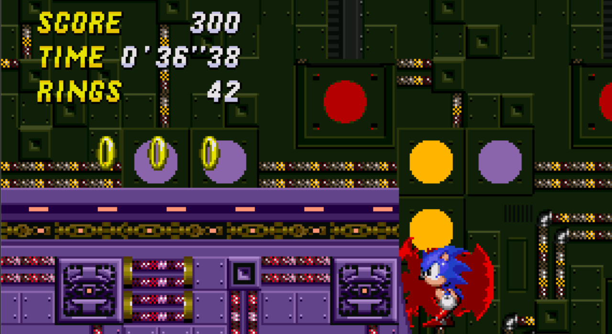

<div align="center">

# SONIC 2
# THE TRUE HISTORY

**The Sonic 2 that could have been.**

Scrapped zones. Reordered eras. One journey through time.

[**Download v1.5**](https://github.com/ehanielchavez-netizen/Sonic2-The-True-History/releases/latest) · [Website](https://ehanielchavez-netizen.github.io/Sonic2-The-True-History/) · [Español](README.es.md) · [Credits](CREDITS.md)



</div>

> **Fan project.** Sonic the Hedgehog and all related characters belong to SEGA.
> Sonic 2 Absolute is a fan project by Team Forever. This mod is unofficial,
> non-commercial, and not affiliated with SEGA or Team Forever.

---

## About

**Sonic 2: The True History** is a campaign mod for **Sonic 2 Absolute 1.1.1 Easy
Setup**. It rebuilds the adventure as an alternate-history version of Sonic 2:
the lost zones survived, the era order changed, and the whole game became a
time-travel story.

This is not a palette swap or a level reskin. The project changes the campaign
structure, the Level Select, the era progression, the boss/finale flow, and
imports several zones and music tracks from community mods. It also adds custom
transitions such as the **Warp Point** and **Hidden Palace**.

The download contains **only the mod**. The repository also hosts this website.
It does **not** include Sonic 2 Absolute, the base game, a ROM, or any game
executable.

---

## The campaign

| Era | Zones |
| --- | --- |
| **Present** | Emerald Hill · Ocean Wind · Jungle Woods · Sand Shower · Metropolis |
| **Past** | Tropical Sun · Aquatic Ruin · Blue Ocean · Hill Top |
| **Ruined Present** | Rock World · Oil Ocean · Mystic Cave |
| **Future** | Casino Night · Chemical Plant · Genocide City |
| **Last Battle** | Sky Chase · Wing Fortress · Death Egg |

**18 zones across 5 eras**, plus the Warp Point and Hidden Palace transitions.

A few honest notes:

- **Blue Ocean is Hydrocity renamed**, not a brand-new level.
- **Genocide City 2 is not included** in this version.
- **Last Battle uses the original Death Egg.** There is no extra Death Egg,
  Gauntlet, or all-boss arena.
- **Rock World** appears only in the Ruined Present, so it is not duplicated
  across eras.

---

## Features

- **A reordered campaign.** The five eras are connected as a single story
  instead of the original progression.
- **Lost zones revived.** Ocean Wind, Jungle Woods, Sand Shower, Tropical Sun,
  Blue Ocean, Rock World and Genocide City are part of the main route.
- **Custom Level Select and menus.** The mod changes the presentation and era
  layout of the game.
- **Warp Point transitions.** The first Warp Point keeps its custom animated
  sequence.
- **Hidden Palace.** The second Warp Point leads to Hidden Palace and then into
  the Ruined Present.
- **A complete finale.** Sky Chase, Wing Fortress and the original Death Egg
  close the campaign.
- **Community soundtrack.** Original Sonic music, remixes and tracks from
  credited community projects.
- **Built as a layer.** The mod is designed to sit on top of Sonic 2 Absolute
  without replacing the base game's core files.

---

## What's new in 1.5

- Corrected the campaign route: **Warp Point 1** ends the Present, **Past → Ruined Present is direct**, **Warp Point 2** ends the Ruined Present, and **Future → Last Battle is direct**.
- **Ocean Wind** uses its Enchanted Edition theme, and **Genocide City** uses the mod's **Death Egg remix**.
- **Hidden Palace** is now the secret zone reached by collecting the **7th Chaos Emerald**; after it you return to the **next zone**, not the same one.
- Restored the **Genocide City turrets** and the rest of the enemies in Act 1 and Act 2.
- **Genocide City Act 1 now leads into Act 2** before Last Battle; the Act 2 stage is no longer skipped.
- Kept the 1.0 fixes: real Genocide City layout, Act 1 layer crash fix, red springs, Act 2 goal post, Killerbug sprites, Warp Point 1 video, Hidden Palace, and clean Cyber City music.
- Base `Data/Game/GameConfig.bin` and `Scripts/LevelSelect/MenuControl.txt` remain untouched.

See [CHANGELOG.md](CHANGELOG.md) for the full technical notes.

---

## Installation

### Requirements

- **Sonic 2 Absolute 1.1.1 Easy Setup** (Windows).
- A clean base installation. The mod does not include the base game.
- About **125 MB** of free space for the mod folder.

### Steps

1. Download the latest **v1.5** release ZIP from the
   [Releases page](https://github.com/ehanielchavez-netizen/Sonic2-The-True-History/releases/latest).
2. Extract the folder **`S2TheRealHistory_1.5`** into:

   ```text
   Sonic2Absolute_1.1.1_EasySetup\Mods\
   ```

3. Open Sonic 2 Absolute and enable **Sonic 2: The True History** in the Mods
   menu.
4. Restart or reload the game if the mod is not picked up immediately.

> **Important:** do not overwrite the base game files
> `Data\Game\GameConfig.bin` or `Scripts\LevelSelect\MenuControl.txt`.
> The mod is intended to work as an overlay.

Back up your save data before installing or updating. This is a fan mod and
save compatibility is not guaranteed between versions.

---

## Controls

The mod uses the standard Sonic 2 Absolute controls. Check the in-game options
for keyboard and controller bindings.

---

## Known issues and limitations

- **Blue Ocean** is Hydrocity with a different name; it is not a new level.
- **Genocide City 2** is not included.
- **Genocide City Star Posts are disabled in 1.5** because of a checkpoint bug.
  Act 1 and Act 2 remain playable, and Act 2 has a goal post.
- **Genocide City Act 2** uses the GCZ source layout available for this release;
  it is not a completely original Act 2.
- **Olympus** and **Madness Mountain** are not fully playable.
- Some imported zones may look or sound different from their original releases.
- If a zone does not load, confirm the mod is enabled and that the base files
  were not overwritten.

More details are in the in-game readmes:
[English](S2TheRealHistory_1.5/readme_us.txt) ·
[Spanish](S2TheRealHistory_1.5/readme_esp.txt).

---

## Credits

This mod would not exist without the work of the Sonic 2 Absolute community.
Full credits and source notes are in [CREDITS.md](CREDITS.md).

The original zone and asset authors did not provide or authorize this material
for the project, and it was not privately shared. It comes from public community
releases. Credits can be corrected or removed on request.

Special thanks to:

- **Team Forever** — Sonic 2 Absolute, engine, scripts and base content.
- **RealidadeMaxima / AlternateUniverse** — Sonic 2 Absolute: Enchanted Edition
  material.
- **S2A Expanded** — Sand Shower and the Cyber City / Genocide City base.
- **Sonic Dreamy Skies** — Super music tracks.
- **Hydrocity Zone (BETA)** and the original Hydrocity authors.
- **Dust Hill & Genocide City Over SS And CC** — Genocide City / Dust Hill data.
The original mod by coolguy98; the S2AE version by Alice the ironic gaymer qween.
- **Sonic 2 Absolute EXTREME** — Metropolis Acts used during testing.
- **Masato Nakamura, SEGA and the Sonic music community** — original music and
  remixes.
- **Hanichav02** — original mod concept and final editing.

If a credit is missing or an author wants their material removed, please open an
issue and it will be handled in an update.

---

## License and disclaimer

This is a **free, non-commercial fan project**. No open-source license is granted
over third-party assets. Original edits by Hanichav02 may be shared in other free
Sonic fan projects with credit, but the mod and its assets may not be sold.

Sonic the Hedgehog, Sonic 2, related characters and original music are trademarks
or copyrights of SEGA. Sonic 2 Absolute belongs to Team Forever. Third-party mod
assets remain the property of their respective authors. This project is not
endorsed by or affiliated with any of them.

This software is provided **as is**, without warranty of any kind. See
[LICENSE.md](LICENSE.md) for the full terms.

---

<div align="center">

**Made with love for the Sonic fan community.**

[Report an issue](https://github.com/ehanielchavez-netizen/Sonic2-The-True-History/issues) ·
[Releases](https://github.com/ehanielchavez-netizen/Sonic2-The-True-History/releases) ·
[Website](https://ehanielchavez-netizen.github.io/Sonic2-The-True-History/)

</div>
